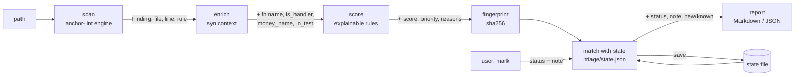

# audit-triage: capstone specification

Status: specification, written before the code. Nothing in this document is implemented yet, except the rule engine inherited from [anchor-lint-v2](https://github.com/bit-nexus-labs/anchor-lint-v2).

## 1. Problem

A security auditor of a Solana (Anchor) program starts with a repository of tens of thousands of lines. A linter such as `anchor-lint` reports hundreds of suspects: every `unwrap`, every `+`, every unchecked account. Three things make that list hard to use:

1. **It is flat.** A `+` on a token balance inside an instruction handler and a `+` on a loop counter in a test helper look the same. The auditor reads in file order, not in risk order.
2. **It has no memory.** After the auditor decides "this one is a false positive" or "confirmed, goes into the report", the next run shows it again from zero. After the team fixes code, line numbers shift and old decisions are lost.
3. **It is not a deliverable.** The result of an audit is a report. Today the auditor copies findings by hand into a document.

`audit-triage` is a command-line tool that turns raw lint findings into a **prioritised, persistent, reportable** list. It does not find new bug classes. It makes the findings of a rule engine usable during a real review, and across several review rounds of the same code base.

Who uses it: a security auditor, alone or in a pair, running it locally on a checked-out repository. One user, one machine, no server.

## 2. Goals and non-goals

### Goals (the tool must do all of these)

- G1. Run the existing rules (R1 may panic, R2 unchecked arithmetic, R3 account without `CHECK:` comment) over a path and collect findings.
- G2. Add **context** to each finding: the enclosing function, whether that function is a public instruction handler, whether the finding touches a name that looks like money (`amount`, `balance`, `lamports`, `fee`, `supply`, `price`), and whether it is in test code.
- G3. Give each finding a **priority** (High, Medium, Low) from a documented, explainable score. The report must show why (the score parts), not only the result.
- G4. Give each finding a **stable fingerprint** that survives line shifts, so a decision made in round 1 is still attached to the same finding in round 2.
- G5. Keep a **state file** with the status of each fingerprint: `open`, `confirmed`, `false-positive`, `fixed`, plus a free-text note.
- G6. Produce a **Markdown report**: findings grouped by priority, each with location, code line, score reasons, status and note; and a diff against the previous run (new, still open, disappeared).
- G7. Be deterministic: the same input gives byte-identical output.

### Non-goals (deliberately out of scope)

- No type checking or data-flow analysis. Context is heuristic and says so in the report.
- No new detection rules beyond R1 to R3. New rules are added to the engine separately.
- No automatic fixing of code.
- No machine learning and no LLM calls inside the tool. Scoring is plain, readable rules, so an auditor can disagree with it and change it.
- No server, web interface, database, accounts or network access.
- No analysis of the compiled program, the runtime, or several programs together (cross-program invocation).
- No IDE plugin, no SARIF or CI integration in the first version (listed under "Later").

## 3. Architecture

Data flows in one direction: **path → findings → enriched findings → scored findings → matched with state → report.**



### 3.1 Crate layout

One Cargo workspace, three crates, so each part can be tested alone:

| Crate | Kind | Responsibility |
|---|---|---|
| `anchor-lint` | library (+ its own small binary, kept) | `lint_source(src) -> findings`. Taken from v2 and changed so a finding carries `rule`, `line` and the span of the token, and so the library does no printing. |
| `triage-core` | library | `Finding` types, enrichment, scoring, fingerprint, state, report. Pure functions over data, no I/O except the state module. |
| `triage-cli` | binary `audit-triage` | argument parsing, reading files, calling `triage-core`, printing, exit codes. The only place that touches the terminal. |

### 3.2 Data model

```text
Finding   { file, line, rule, snippet }                     // from the engine
Context   { fn_name: Option<String>, is_handler: bool,      // from syn
            money_name: bool, in_test: bool }
Scored    { finding, context, score: u32, priority, reasons: Vec<Reason> }
Fingerprint = sha256( rule | file path relative to root | fn_name | normalised snippet )
Entry     { fingerprint, status, note, first_seen, last_seen }
```

The fingerprint does **not** contain the line number. The normalised snippet is the source line with whitespace collapsed. If the code is moved, the fingerprint stays. If the line is edited, the fingerprint changes and the finding comes back as `new`, which is the safe direction: a changed line deserves a new look.

### 3.3 Scoring (the heuristic, written out)

Score is a sum of named parts, each shown in the report:

| Part | Points |
|---|---|
| base: R3 account without CHECK | 5 |
| base: R2 unchecked arithmetic | 4 |
| base: R1 may panic | 3 |
| inside a public instruction handler | +3 |
| touches a money-like name | +3 |
| inside a function that is not a handler | +0 |
| in test code | finding is dropped before scoring |

Priority: High at 9 or more, Medium at 6 to 8, Low below 6. The numbers are constants in one file, with a comment for each, so they can be tuned. A "handler" is a `pub fn` inside a `#[program]` module, which is how Anchor declares instructions.

### 3.4 Command line

```
audit-triage scan   <path> [--state <file>]      # scan, update state, print a short summary
audit-triage report <path> [--state <file>] [--out <file>] [--format md|json]
audit-triage mark   <fingerprint-prefix> <status> [--note "text"] [--state <file>]
```

`--state` defaults to `<path>/.triage/state.json`. Exit codes: `0` ok, `1` at least one open High finding (so it can gate a pipeline later), `2` run problem (bad path, unreadable file, broken state file).

### 3.5 Technologies and why

| Choice | Why |
|---|---|
| Rust, stable, edition 2021 | the language of the programs under audit and of the course; one static binary for the auditor |
| `syn` 2 (`full`, `visit`) + `proc-macro2` (`span-locations`) | already used by the rule engine; the same parser gives function names and `#[program]` detection, no second parser |
| `serde` + `serde_json` | the state file and the JSON report; the standard way, readable and diffable in git |
| `sha2` | a fingerprint must be identical on every machine and Rust version; the standard library hasher does not promise that |
| `clap` 4 (derive) | three subcommands with options; hand-written argument parsing would be longer and worse than the library here (in v2 no library was right because there was one argument) |
| `anyhow` | errors with context in the binary (`reading state file X: ...`) |
| dev: `tempfile`, `assert_cmd` | tests that run the real binary on a temporary copy of a sample project |
| `std` only for the rest | file walk, sorting, string work, Markdown output |

No async runtime, no `regex`, no database. A state of some thousands of entries fits in one JSON file.

## 4. How we verify it is done

The tool is done when all checks below pass, on the sample project `fixtures/vault/` (a small, invented Anchor-style program kept in the repository, with known findings).

| # | Check | How |
|---|---|---|
| V1 | Engine parity | on `fixtures/vault` the finding set equals the expected list in `fixtures/vault/EXPECTED.txt` (file, line, rule) |
| V2 | Context | a `+` on `amount` inside a `#[program]` `pub fn` is High; the same `+` on `i` inside a helper is Low; a finding inside `#[cfg(test)]` does not appear |
| V3 | Explainable | every finding in the report lists its score parts; the sum of parts equals the score (unit test) |
| V4 | Stable fingerprint | insert 10 blank lines above a finding: same fingerprint. Edit the flagged line: different fingerprint |
| V5 | Memory | `mark` a finding `false-positive`, run `scan` again after inserting blank lines: it stays `false-positive` and is not counted as new |
| V6 | Diff | fix one finding in the fixture, run `scan`: the report lists it as "disappeared" and the entry becomes `fixed` |
| V7 | Determinism | two runs on the same input give byte-identical Markdown and JSON |
| V8 | Failure modes | missing path, broken JSON state, a file that does not parse: exit code 2, message names the file, other files are still processed |
| V9 | Quality gates | `cargo build` with no warnings, `cargo clippy --all-targets -- -D warnings`, `cargo fmt --check`, `cargo test` green; no `unwrap`/`expect` outside tests (the tool passes its own R1) |
| V10 | Real-world run | one run on a real open-source Anchor repository; the report is read by a human, and false-positive rate and time to run are written in the README |

## 5. Milestones

1. **M1.** Split `anchor-lint` into library plus binary; `Finding` with span; tests still green. (V1)
2. **M2.** Enrichment and scoring, with the reasons list. (V2, V3)
3. **M3.** Fingerprint and the state file, `mark` and `scan`. (V4, V5, V6)
4. **M4.** Markdown and JSON report, diff section. (V6, V7)
5. **M5.** Failure modes, real-world run, README with measured results. (V8 to V10)

If time runs out, M1 to M4 is the minimum that is still a useful tool; M5 is the part that proves it.

## 6. Risks and open questions

- **Heuristic quality.** "Money-like name" will misfire. Mitigation: show the reasons, keep weights in one file, measure on a real repository (V10), and say plainly what was measured.
- **Fingerprint too strict or too loose.** A snippet-based fingerprint treats a reformatted line as new. Accepted on purpose (see 3.2); revisit after V10.
- **Macro-generated code** is invisible to the engine (known limit of v2). The report header states it.
- **Scope creep.** The rule list will tempt additions. Rule: new rules only after V1 to V9 pass.

## 7. Later (not in this capstone)

SARIF output for CI, more rules (signer checks, owner checks, PDA seed review), reading `#[account(...)]` constraints, a baseline file for pipelines, and an optional assistant step that drafts report text, kept outside the core so scoring stays deterministic.
